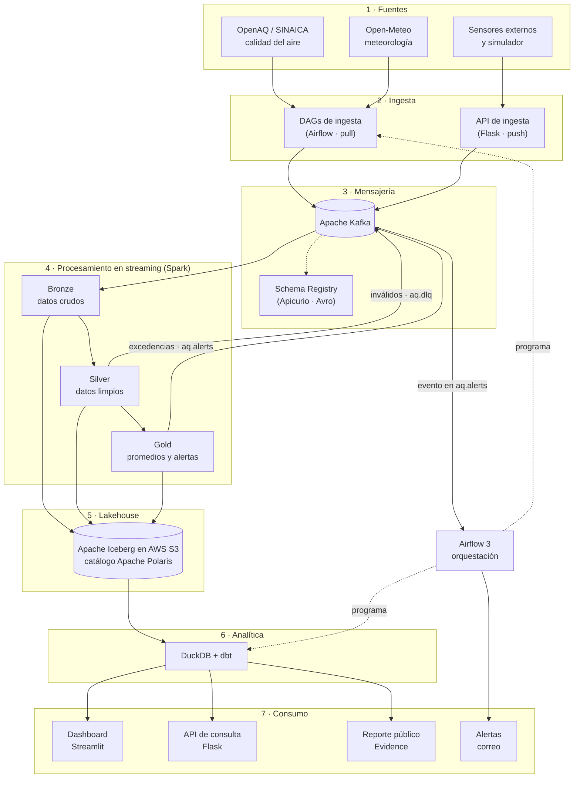

# AireNL — Arquitectura del sistema

AireNL es una plataforma de datos open source que recolecta mediciones de calidad del aire del Área Metropolitana de Monterrey (AMM), las procesa en tiempo casi real, envía alertas cuando se rebasan los límites de salud y produce análisis reproducibles para política pública.

Este documento explica qué hace el sistema, de qué piezas está hecho, qué hace cada una y cómo se construye. Está escrito para que alguien sin experiencia en estas herramientas pueda entender el proyecto y su valor.

---

## 1. Contexto

### El problema

- El AMM tiene uno de los problemas de calidad del aire más serios del país, sobre todo por partículas finas (PM2.5 y PM10) y ozono.
- Los datos existen, pero están dispersos en varias fuentes públicas, con formatos y unidades distintas, huecos y errores de captura.
- Las normas mexicanas de salud (NOM-025-SSA1-2021 para partículas y NOM-020-SSA1-2021 para ozono) definen límites, pero responder preguntas simples como "¿cuántos días al año se rebasó el límite en mi zona?" requiere mucho trabajo manual.

### Qué hace AireNL

1. **Recolecta** mediciones de contaminantes y de clima desde fuentes públicas, de forma automática y continua.
2. **Limpia y estandariza** los datos: elimina duplicados, corrige unidades y separa los registros inválidos.
3. **Calcula** promedios móviles por estación y contaminante, y los compara con los límites vigentes de la norma.
4. **Alerta** por correo cuando una estación rebasa un límite.
5. **Analiza**: genera tablas listas para responder preguntas de política pública, un dashboard en vivo, una API de consulta y un reporte público.

### Preguntas que guían el proyecto

- **Política pública:** ¿con qué frecuencia, en qué zonas y a qué horas del AMM se rebasan los límites de salud, y qué papel juega la meteorología?
- **Técnica:** ¿cómo construir un sistema confiable que tolere datos tardíos, duplicados y cambios de formato en fuentes públicas heterogéneas?

---

## 2. Vista general

El sistema se organiza en capas. Cada dato entra por la capa de ingesta, viaja por Kafka, se procesa en tres etapas de calidad creciente y termina disponible para análisis, alertas y consulta. Airflow coordina las tareas programadas y las que reaccionan a eventos.



| Capa | Pregunta que responde | Herramientas |
| --- | --- | --- |
| 1. Fuentes | ¿De dónde vienen los datos? | OpenAQ, SINAICA, Open-Meteo, simulador |
| 2. Ingesta | ¿Cómo entran al sistema? | Airflow 3 (pull), Flask (push) |
| 3. Mensajería | ¿Cómo viajan sin perderse? | Apache Kafka, Apicurio Registry, Avro |
| 4. Procesamiento | ¿Cómo se limpian y calculan en tiempo casi real? | Apache Spark Structured Streaming |
| 5. Lakehouse | ¿Dónde se guardan de forma confiable? | Apache Iceberg, Apache Polaris, AWS S3 |
| 6. Analítica | ¿Cómo se convierten en respuestas? | DuckDB, dbt |
| 7. Consumo | ¿Quién los usa y cómo? | Streamlit, Flask, Evidence, Correo |
| Transversal | ¿Quién coordina y vigila todo? | Airflow 3, GitHub Actions, pytest |

---

## 3. Glosario para no especialistas

| Término | Qué es | Analogía |
| --- | --- | --- |
| API | Una "ventanilla" por la que un programa pide o entrega datos a otro | La ventanilla de un banco: hay reglas para lo que puedes pedir y cómo |
| Pull y push | Pull: el sistema va a buscar los datos. Push: alguien más se los envía | Ir al buzón (pull) contra recibir una entrega a domicilio (push) |
| Streaming | Procesar los datos conforme llegan, en lugar de esperar a juntar todo el día | Una banda transportadora contra lavar toda la ropa el domingo |
| Kafka y topic | Kafka es un sistema que recibe, guarda en orden y reparte mensajes. Un topic es una "fila" de mensajes de un mismo tipo | Una oficina de correos con casilleros por tema, que además guarda copia de cada carta |
| Esquema (Avro) | El contrato que define qué campos lleva cada mensaje y de qué tipo | El formato oficial de un trámite: si falta un campo, se rechaza |
| Lakehouse | Almacenamiento barato de archivos con las garantías de una base de datos | Una bodega enorme con un inventario exacto de dónde está cada caja |
| Iceberg | Un formato de tabla que permite actualizar datos de forma segura y consultar versiones anteriores | Un libro de contabilidad donde nada se borra: cada cambio queda registrado |
| Catálogo (Polaris) | El registro central que dice qué tablas existen y dónde están sus archivos | El índice de una biblioteca |
| Orquestador (Airflow) | El programa que decide qué tarea corre, cuándo, en qué orden y qué hacer si falla | Un director de orquesta con calendario y plan B |
| DAG | Un flujo de trabajo en Airflow: tareas conectadas en un orden definido | Una receta: primero picar, luego sofreír, luego servir |
| dbt | Una herramienta para escribir transformaciones en SQL de forma ordenada, documentada y probada | Recetas estandarizadas de cocina industrial, con control de calidad |
| Bronze, silver y gold | Tres niveles de calidad del dato: crudo, limpio y listo para analizar | Mineral, metal refinado y joya terminada |

---

## 4. El recorrido de un dato

Ejemplo ilustrativo de cómo viaja una sola medición por el sistema:

1. **Medición.** A las 14:00 una estación del centro de Monterrey registra PM2.5 = 48 µg/m³ y la publica en OpenAQ.
2. **Ingesta.** A las 14:15 corre el DAG `ingest_openaq` de Airflow. Pide a OpenAQ las mediciones de los últimos 15 minutos, encuentra este dato, lo traduce al esquema estándar y lo publica en Kafka, en el topic `aq.measurements.raw`.
3. **Contrato.** Antes de publicarse, el mensaje se valida contra su esquema Avro en el Schema Registry. Si le faltara un campo obligatorio, se rechazaría ahí mismo.
4. **Bronze.** Segundos después, el job de Spark de bronze lee el mensaje y lo guarda tal cual en una tabla Iceberg, junto con datos de trazabilidad: cuándo llegó y de qué posición de Kafka salió.
5. **Silver.** El job de silver revisa que el valor sea físicamente posible, convierte unidades si hace falta y descarta duplicados. El dato es válido, así que se escribe en la tabla limpia.
6. **Gold.** El job de gold recalcula el promedio de 24 horas de PM2.5 de esa estación. Si el promedio rebasa el límite vigente de la NOM-025, publica un mensaje en el topic `aq.alerts`.
7. **Alerta.** Airflow detecta el mensaje nuevo en `aq.alerts` y dispara el DAG `alert_dispatch`, que arma un mensaje legible y lo envía por correo.
8. **Análisis.** A las 06:00 del día siguiente, el DAG `dbt_daily` reconstruye las tablas analíticas. El dato ya forma parte del conteo de "días fuera de norma" de esa estación.
9. **Consumo.** El dashboard, la API de consulta y el reporte público muestran el resultado.

Del paso 1 al 7 pasan pocos minutos. El paso 8 corre una vez al día porque el análisis de política no necesita actualizarse cada segundo.

---

## 5. Módulos

Cada módulo se describe con el mismo formato: qué hace, por qué existe, cómo se construye y dónde vive en el repositorio.

### 5.1 Fuentes de datos

**Qué hace:** provee las mediciones crudas.

| Fuente | Qué aporta | Acceso | Uso |
| --- | --- | --- | --- |
| OpenAQ API v3 | Mediciones de estaciones de gobierno, armonizadas | API REST con key gratuita y límite de solicitudes | Ingesta continua cada 15 minutos |
| SINAICA (INECC) | Histórico de las redes estatales, incluida la de Nuevo León | Endpoints web públicos | Carga histórica de 3 a 5 años |
| Open-Meteo | Temperatura, viento, humedad y altura de capa de mezcla | API gratuita sin key | Ingesta horaria y cruce en el análisis |
| Sensores externos y simulador | Datos enviados por terceros, o históricos reproducidos a alta velocidad con errores controlados | Envío a la API de ingesta (Flask) | Pruebas de carga y de robustez |
| Normas oficiales | Límites de salud con fechas de vigencia | Transcripción del DOF | Tabla de referencia (`nom_limits`) |

**Por qué un simulador:** las estaciones reportan una vez por hora, lo que no basta para probar un sistema de streaming. El simulador reproduce el histórico a 10x–1000x e inyecta errores marcados (duplicados, mensajes tardíos, nulos, unidades equivocadas) para medir cuántos detecta el sistema. Esta decisión se declara abiertamente en el README.

### 5.2 Ingesta

La ingesta tiene dos entradas complementarias, y ambas terminan en Kafka.

#### 5.2.1 DAGs de ingesta en Airflow (pull)

**Qué hace:** cada cierto tiempo, Airflow va a buscar datos a las APIs públicas y los publica en Kafka.

**Por qué con Airflow:** las fuentes públicas no envían datos; hay que pedirlos periódicamente. Airflow ya resuelve lo difícil de eso: horarios, reintentos, historial de corridas, alertas de falla y reprocesar periodos pasados (backfill).

**Cómo se construye:**

- Un cliente reutilizable por fuente (`ingestion/clients/openaq.py`, `open_meteo.py`, `sinaica.py`) con `httpx`, paginación, reintentos con espera exponencial y respeto del límite de solicitudes.
- Cada corrida pide **solo su ventana de tiempo**: la corrida de las 14:15 pide de 14:00 a 14:15. Esto hace la ingesta idempotente: correrla dos veces no duplica datos y permite reprocesar cualquier periodo con un backfill de Airflow.
- El cliente traduce cada respuesta al esquema estándar `measurement` o `weather`.
- La publicación a Kafka se hace con el provider de Kafka para Airflow (`ProduceToTopicOperator`) o con una tarea de Python que usa `confluent-kafka` y el serializador Avro del registry.
- Extraer y publicar ocurren en la misma tarea. Las tareas de Airflow no se pasan grandes volúmenes de datos entre sí; su mecanismo para compartir información (XCom) es solo para datos pequeños.

| DAG | Horario | Qué hace |
| --- | --- | --- |
| `ingest_openaq` | Cada 15 minutos | OpenAQ → `aq.measurements.raw` |
| `ingest_weather` | Cada hora | Open-Meteo → `weather.observations.raw` |
| `sinaica_backfill` | Manual, con fechas como parámetros | SINAICA → archivos Parquet en S3; opcionalmente los reproduce a Kafka |

#### 5.2.2 API de ingesta en Flask (push)

**Qué hace:** ofrece una "ventanilla" HTTP para que terceros (sensores, socios, el simulador) envíen mediciones. La API valida cada envío y lo publica en Kafka.

**Por qué existe:** muchas fuentes reales funcionan por push, como los sensores de bajo costo que envían su lectura cada minuto. La API desacopla a esos emisores de Kafka: no necesitan saber que Kafka existe, solo hacer un `POST`. Además, rechaza datos mal formados antes de que entren al sistema.

**Cómo se construye:**

- Flask 3 con `gunicorn` en su propio contenedor.
- Validación de cada payload con Pydantic, usando los mismos campos que el esquema Avro.
- Un productor de Kafka por proceso, con callbacks de entrega para registrar fallos y `flush()` al apagarse.
- Autenticación por API key en el header `X-API-Key`.
- Pruebas con pytest y el cliente de pruebas de Flask, con Kafka simulado.

| Método | Ruta | Qué hace | Respuestas |
| --- | --- | --- | --- |
| `POST` | `/v1/ingest/measurements` | Recibe una o varias mediciones en JSON y las publica en `aq.measurements.raw` | `202` aceptado · `422` datos inválidos · `401` sin key · `503` Kafka no disponible |
| `GET` | `/v1/health` | Estado de la API y de su conexión con Kafka | `200` / `503` |

Ejemplo de envío:

```json
POST /v1/ingest/measurements
X-API-Key: <tu-key>

{
  "measurements": [
    {
      "station_id": "nl-centro-01",
      "sensor_id": "pm25-01",
      "parameter": "pm25",
      "value": 48.0,
      "unit": "ug/m3",
      "measured_at": "2027-01-15T14:00:00-06:00",
      "source": "simulator"
    }
  ]
}
```

#### 5.2.3 Simulador

**Qué hace:** lee el histórico de SINAICA en Parquet y lo envía a la API de ingesta en orden cronológico, a la velocidad que se indique (`--speed 100`) y con un porcentaje de errores marcados (`--error-rate 0.03`).

**Cómo se construye:** script de Python en `ingestion/simulator/`. Para pruebas de carga extremas puede publicar directo a Kafka y saltarse la API.

### 5.3 Mensajería: Kafka y Schema Registry

**Qué hace:** recibe todos los mensajes de la ingesta, los guarda en orden y en disco, y los reparte a quien los necesite.

**Por qué existe:** separa a quien produce los datos de quien los procesa. Si Spark se detiene una hora, los mensajes esperan en Kafka y nada se pierde; si una fuente se cae, el resto del sistema sigue funcionando. También permite reprocesar datos desde cualquier punto.

**Cómo se construye:**

- Apache Kafka 4.x en modo KRaft (sin ZooKeeper), con un broker en Docker.
- Dos listeners: uno interno para los contenedores y otro en `localhost` para la Mac.
- Apicurio Registry guarda los esquemas Avro (`schemas/*.avsc`) y verifica que sus cambios sean compatibles con las versiones anteriores.
- Kafka UI para inspeccionar topics y mensajes durante el desarrollo.

| Topic | Particiones | Llave | Contenido | Quién lo produce | Quién lo consume |
| --- | --- | --- | --- | --- | --- |
| `aq.measurements.raw` | 6 | `station_id` | Mediciones de contaminantes | DAGs de ingesta, API Flask | Spark (bronze) |
| `weather.observations.raw` | 3 | `station_id` | Observaciones meteorológicas | DAG `ingest_weather` | Spark (bronze) |
| `aq.dlq` | 1 | `station_id` | Registros rechazados con el motivo | Spark (silver) | DAG `dlq_daily_report` |
| `aq.alerts` | 1 | `station_id` + contaminante | Excedencias de límites | Spark (gold) | DAG `alert_dispatch` |

Usar `station_id` como llave garantiza que todas las mediciones de una estación queden en la misma partición y conserven su orden.

### 5.4 Procesamiento en streaming: Spark Structured Streaming

**Qué hace:** lee continuamente de Kafka y escribe tres tablas, cada una de mayor calidad que la anterior (arquitectura medallion).

**Por qué Spark:** procesa los datos en pequeños lotes cada pocos segundos, recuerda dónde se quedó si se reinicia (checkpoints) y maneja ventanas de tiempo y datos tardíos, cosas que un orquestador no está diseñado para hacer.

| Job | Entrada | Qué hace | Salida |
| --- | --- | --- | --- |
| Bronze | Topics `*.raw` | Decodifica el Avro y guarda el dato sin modificar, con offset, partición y hora de llegada | `aq.bronze_measurements`, `aq.bronze_weather` |
| Silver | Bronze | Valida rangos físicos, convierte unidades, estandariza horarios a UTC y elimina duplicados por `sensor_id` + `measured_at`; envía los inválidos a `aq.dlq` con el motivo | `aq.silver_measurements`, `aq.silver_weather` |
| Gold | Silver | Calcula promedios móviles de 1, 8 y 24 horas por estación y contaminante | `aq.gold_rolling_averages` |
| Alertas | Gold + `nom_limits` | Compara contra el límite vigente y publica excedencias, con una sola alerta por estación y contaminante cada 3 horas | Topic `aq.alerts` |

**Cómo se construye:**

- PySpark con el runtime de Iceberg y el catálogo REST de Polaris.
- Un checkpoint propio por job, para retomar exactamente donde se quedó tras un fallo.
- Watermark de 2 horas: los datos que llegan con hasta 2 horas de retraso entran al cálculo en vivo; los más tardíos se quedan en bronze y el build diario de dbt los incorpora.
- Escritura con `MERGE` dentro de `foreachBatch`, para que reprocesar un lote no duplique filas.
- Pruebas unitarias de cada regla de validación con DataFrames pequeños.

### 5.5 Almacenamiento: lakehouse con Iceberg, Polaris y S3

**Qué hace:** guarda todas las tablas de forma durable, barata y consultable desde varios motores.

**Cómo funciona, en tres piezas:**

- **AWS S3** guarda los archivos (Parquet). Es el almacenamiento de objetos más usado de la industria y cuesta centavos para este volumen.
- **Apache Iceberg** organiza esos archivos como tablas: permite actualizaciones seguras, consultar versiones anteriores (time travel) y cambiar el esquema sin reescribir los datos.
- **Apache Polaris** es el catálogo: sabe qué tablas existen, dónde están sus archivos y quién puede leerlas. Es proyecto de nivel superior de Apache y es la base del catálogo de Snowflake.

**Cómo se construye:**

- Bucket S3 con acceso público bloqueado, cifrado por defecto y una regla que borra los archivos de bronze a los 30 días.
- Rol IAM de mínimo privilegio, que solo da acceso a ese bucket; Polaris entrega credenciales temporales a Spark y DuckDB.
- Polaris corre en Docker, con Postgres para que el catálogo sobreviva a los reinicios.
- Mantenimiento semanal (compactar archivos pequeños y expirar versiones viejas) orquestado por Airflow.

### 5.6 Transformación analítica: DuckDB y dbt

**Qué hace:** convierte las tablas limpias en tablas de análisis que responden directamente las preguntas de política pública.

**Por qué estas herramientas:** DuckDB es un motor analítico muy rápido que corre dentro de un programa, sin servidor, y lee tablas Iceberg directamente. dbt organiza las transformaciones SQL en modelos versionados, con pruebas, documentación y linaje.

| Capa de dbt | Modelo | Qué responde |
| --- | --- | --- |
| Staging | `stg_measurements`, `stg_weather`, `stg_stations` | Datos de silver con nombres y tipos estandarizados |
| Intermediate | `int_daily_averages` | Promedio diario por estación y contaminante, aplicando el criterio de suficiencia de datos de la norma |
| Intermediate | `int_station_completeness` | Qué porcentaje de horas tiene dato cada estación |
| Marts | `mart_excedencias_diarias` | ¿Qué días y en qué estaciones se rebasó el límite vigente? |
| Marts | `mart_perfil_horario` | ¿A qué horas, días y meses se concentra la contaminación? |
| Marts | `mart_clima_vs_contaminacion` | ¿Cómo se relaciona la contaminación con viento, temperatura y capa de mezcla? |
| Seeds | `nom_limits` | Límites de cada norma con sus fechas de vigencia |

**Cómo se construye:**

- dbt v2 con el adaptador de DuckDB; si el adaptador en beta presenta problemas, dbt-core 1.x con `dbt-duckdb`.
- DuckDB se conecta a Polaris con `ATTACH` al inicio de cada ejecución.
- Pruebas genéricas, unit tests y contratos de modelo en los marts.
- Los límites de la norma se guardan con fechas de vigencia, porque los límites de partículas se endurecen de forma gradual.

### 5.7 Orquestación: Airflow 3

**Qué hace:** decide qué tarea corre y cuándo, reintenta las que fallan, guarda el historial y avisa cuando algo sale mal.

**Dos formas de disparar un DAG:**

- **Por horario:** "cada 15 minutos" o "todos los días a las 06:00".
- **Por evento:** Airflow 3 vigila un topic de Kafka y lanza un DAG en cuanto llega un mensaje (event-driven scheduling, con `AssetWatcher` y `MessageQueueTrigger`).

| DAG | Disparador | Qué hace |
| --- | --- | --- |
| `ingest_openaq` | Cada 15 minutos | Ingesta de contaminantes (sección 5.2.1) |
| `ingest_weather` | Cada hora | Ingesta de meteorología |
| `sinaica_backfill` | Manual | Carga histórica |
| `alert_dispatch` | Evento: mensaje nuevo en `aq.alerts` | Da formato legible a la alerta (estación, contaminante, valor, límite, hora local) y la envía por correo |
| `dlq_daily_report` | Diario, 07:00 | Lee `aq.dlq`, guarda los rechazos en la tabla `quality.rejected_records` y envía un resumen por motivo de rechazo |
| `dbt_daily` | Diario, 06:00 | `dbt build` completo, con cada modelo visible como una tarea gracias a Astronomer Cosmos |
| `iceberg_maintenance` | Semanal | Compacta archivos y expira versiones viejas |
| `silver_freshness` | Cada 30 minutos | Revisa que silver siga recibiendo datos y avisa si no |

**Cómo se construye:**

- Airflow 3 en Docker con LocalExecutor: API server, scheduler, procesador de DAGs y triggerer (el componente que vigila eventos), con una base propia en el Postgres de Polaris.
- Providers de Kafka y de mensajería común para producir, consumir y reaccionar a mensajes.
- Conexiones y variables de Airflow para guardar credenciales (AWS, Correo Electrónico, OpenAQ) fuera del código.
- Si Cosmos no soporta la versión de dbt en uso, `dbt_daily` corre `dbt build` con un `BashOperator`.

**Qué hace Airflow y qué no:** Airflow procesa por lotes y por eventos puntuales: ingesta programada, alertas, reportes diarios, dbt y mantenimiento. El procesamiento continuo de cada medición (bronze, silver y gold) lo hace Spark, porque ese trabajo necesita estado, ventanas de tiempo y latencia de segundos. Ver la sección 6.

### 5.8 Consumo

| Componente | Para quién | Qué ofrece | Cómo se construye |
| --- | --- | --- | --- |
| Dashboard en vivo | Demo y monitoreo | Mapa de estaciones según si rebasan el límite, serie de las últimas 24 horas, alertas activas y métricas operativas | Streamlit leyendo gold mediante DuckDB |
| API de consulta | Otras aplicaciones | Estaciones, últimas mediciones y alertas recientes en JSON | El mismo servicio Flask de la ingesta, con rutas de solo lectura sobre DuckDB |
| Reporte público | Ciudadanía, academia, tomadores de decisión | Hallazgos, metodología, limitaciones y recomendaciones | Evidence (SQL + Markdown) publicado como sitio estático en GitHub Pages |
| Alertas | Cualquier persona suscrita | Mensaje inmediato cuando se rebasa un límite | Bot de correo, enviado por el DAG `alert_dispatch` |

Rutas de la API de consulta:

| Método | Ruta | Devuelve |
| --- | --- | --- |
| `GET` | `/v1/stations` | Catálogo de estaciones con ubicación y contaminantes |
| `GET` | `/v1/stations/{station_id}/latest` | Últimos promedios de 1, 8 y 24 h por contaminante |
| `GET` | `/v1/alerts?since=2027-01-15T00:00:00Z` | Alertas emitidas desde una fecha |

### 5.9 Calidad, observabilidad y CI

- **Contratos de datos:** los esquemas Avro rechazan mensajes mal formados desde la entrada.
- **Calidad en el flujo:** silver separa los registros inválidos con su motivo, sin detener el resto del flujo.
- **Pruebas:** pytest para clientes, API y reglas de Spark; tests y contratos de dbt para los modelos.
- **CI con GitHub Actions:** en cada push corre ruff, pytest, `dbt build` sobre una muestra fija en DuckDB y una prueba que confirma que todos los DAGs de Airflow cargan sin errores.
- **Métricas operativas en el dashboard:** retraso de los consumidores de Kafka (lag), porcentaje de mensajes rechazados y latencia de extremo a extremo (de la medición a gold).

---

## 6. Decisiones de diseño

| Decisión | Por qué | Alternativa descartada |
| --- | --- | --- |
| Kafka entre la ingesta y el procesamiento | Desacopla fuentes y procesamiento, absorbe picos y permite reprocesar | Escribir directo de la ingesta a las tablas: una falla en cualquier paso perdería datos |
| Dos entradas de ingesta (Airflow pull y Flask push) | Las fuentes públicas hay que consultarlas; los sensores y socios envían por su cuenta | Un solo mecanismo no cubre ambos casos |
| Formateo continuo en Spark, no en Airflow | Airflow está hecho para lanzar tareas; correr un DAG por cada medición agregaría segundos de arranque a cada mensaje y saturaría el scheduler | Consumir cada mensaje con un DAG de Airflow |
| Airflow reacciona a eventos solo para casos puntuales | Las alertas son pocas y cada una justifica un flujo completo: formateo, envío y registro | Un consumidor de Kafka propio, que habría que monitorear aparte |
| At-least-once + `MERGE` idempotente | Evita duplicados sin la complejidad de transacciones exactly-once | Exactly-once de punta a punta |
| Iceberg + Polaris + S3 | Formato abierto que leen Spark, DuckDB, Trino y Snowflake, sobre el almacenamiento estándar de la industria | Delta Lake, ya cubierto en experiencia previa con Databricks |
| Spark para streaming, DuckDB para análisis | Spark maneja estado y ventanas; DuckDB es más rápido y barato para consultas analíticas pequeñas | Un solo motor para todo |
| Cómputo local, datos en la nube | Docker en la laptop cuesta cero; S3 cuesta centavos y se parece a producción | Todo en la nube (costo) o todo local (menos realista) |
| Límites de la norma como tabla con vigencias | Los límites cambian con el tiempo; cada fecha se evalúa con el límite que aplicaba ese día | Límites fijos en el código |

---

## 7. Manejo de fallos

| Qué falla | Qué pasa | Cómo se recupera |
| --- | --- | --- |
| La API de OpenAQ no responde | La tarea reintenta con espera exponencial; si se agotan los intentos, la corrida falla | Airflow reintenta la corrida; como cada una pide su propia ventana de tiempo, un backfill recupera el hueco sin duplicar |
| La API Flask no puede escribir en Kafka | Responde `503` y el emisor reintenta | Los callbacks de entrega registran cada fallo; `/v1/health` lo hace visible |
| Kafka se reinicia | Los mensajes confirmados están en disco | Productores y consumidores se reconectan solos |
| Un job de Spark se detiene | Los mensajes se acumulan en Kafka | Al reiniciar retoma desde su checkpoint; `MERGE` evita duplicados |
| Llega un dato inválido | Silver lo envía a `aq.dlq` con el motivo | `dlq_daily_report` lo guarda y resume; el flujo no se detiene |
| Llega un dato con mucho retraso | Queda fuera del cálculo en vivo, pero se guarda en bronze | El build diario de dbt lo incorpora al análisis |
| Llega un dato duplicado | Silver lo descarta por `sensor_id` + `measured_at` | No requiere acción |
| Polaris se reinicia | El catálogo está en Postgres | Sin pérdida |
| Silver deja de recibir datos | `silver_freshness` lo detecta en menos de 30 minutos | Aviso por correo para revisar |

---

## 8. Ejecución local

**Requisitos:** Mac con Apple Silicon y 16 GB de RAM (10 GB asignados a Docker), OrbStack o Docker Desktop, `uv`, AWS CLI con el perfil `airenl`, y las variables de `.env.example` completadas.

Los servicios se agrupan en perfiles de Docker Compose para levantar solo lo necesario:

| Perfil | Servicios |
| --- | --- |
| `core` | Kafka, Kafka UI, Apicurio, Postgres, Polaris |
| `ingestion` | API Flask, simulador |
| `streaming` | Jobs de Spark |
| `orchestration` | Airflow (API server, scheduler, procesador de DAGs, triggerer) |
| `serving` | Dashboard Streamlit |

```bash
make up            # perfil core
make up-all        # todos los perfiles
make simulate      # simulador a 100x con 3% de errores
make demo          # todo + dashboard abierto en el navegador
make test          # ruff + pytest + dbt build sobre la muestra
make down
```

| Servicio | URL local |
| --- | --- |
| Airflow | http://localhost:8080 |
| Kafka UI | http://localhost:8081 |
| Apicurio Registry | http://localhost:8082 |
| Polaris | http://localhost:8181 |
| API Flask | http://localhost:5001 (el puerto 5000 lo ocupa AirPlay en macOS) |
| Streamlit | http://localhost:8501 |
| Spark UI | http://localhost:4040 |

---

## 9. Estructura del repositorio

```
airenl/
├── README.md
├── Makefile
├── docker-compose.yml           # Servicios agrupados por perfil
├── .env.example                 # OPENAQ_API_KEY, EMAIL, AWS_PROFILE, INGEST_API_KEY
├── docs/
│   ├── architecture.md          # Este documento
│   ├── adr/                     # Registro de decisiones técnicas
│   ├── bitacora.md
│   └── policy-report/           # Reporte público (Evidence)
├── schemas/                     # measurement.avsc, weather.avsc, alert.avsc
├── api/                         # Servicio Flask
│   ├── app.py
│   ├── routes/ingest.py         # POST /v1/ingest/measurements
│   ├── routes/query.py          # GET /v1/stations, /v1/alerts
│   ├── models.py                # Validación con Pydantic
│   └── tests/
├── ingestion/
│   ├── clients/                 # openaq.py, open_meteo.py, sinaica.py
│   ├── kafka/                   # Productor y serializadores Avro compartidos
│   ├── simulator/               # replay.py
│   └── tests/
├── orchestration/
│   └── dags/                    # ingest_*, alert_dispatch, dlq_daily_report, dbt_daily, ...
├── streaming/
│   ├── jobs/                    # bronze.py, silver.py, gold.py, alerts.py
│   ├── common/                  # Sesión de Spark y configuración de Iceberg
│   └── tests/
├── analytics/                   # Proyecto dbt
│   ├── models/{staging,intermediate,marts}/
│   ├── seeds/                   # nom_limits.csv, stations.csv
│   └── tests/
├── dashboard/                   # app.py de Streamlit
├── infra/                       # Política IAM, bucket S3 y lifecycle rules
└── .github/workflows/ci.yml
```

---

## 10. Valor del proyecto

**Para la ciudadanía y la política pública**

- Convierte datos públicos dispersos en respuestas directas: días fuera de norma, zonas y horarios críticos, y el peso de la meteorología.
- Es reproducible: cualquier persona puede verificar cada cifra con el código y los datos abiertos.
- Evalúa cada fecha contra el límite que estaba vigente ese día, incluidos los límites graduales de la NOM-025.

**Como ejemplo de ingeniería de datos**

- Integra ingesta por pull y por push, streaming, lakehouse abierto, transformación analítica y orquestación por horario y por evento en un solo sistema funcional.
- Usa herramientas de amplia adopción en la industria (Kafka, Spark, Iceberg, Airflow, dbt, S3) en una arquitectura que se parece a la de producción.
- Documenta sus decisiones, sus limitaciones y cómo se recupera de cada tipo de falla.

---

## 11. Limitaciones

- Las estaciones reportan cada hora; el volumen de streaming viene del simulador.
- Los datos de las fuentes son preliminares; las redes estatales pueden validarlos o corregirlos después.
- Las estaciones no cubren todas las colonias del AMM; los resultados describen la zona de cada estación.
- El análisis estadístico describe asociaciones entre clima y contaminación, no relaciones causales.
- El sistema corre en una sola máquina; Kafka tiene un broker sin replicación. Llevarlo a producción requeriría varios brokers, cómputo administrado y monitoreo dedicado.

---

## Referencias

- [OpenAQ API](https://docs.openaq.org/)
- [SINAICA (INECC)](https://sinaica.inecc.gob.mx/)
- [Apache Kafka](https://kafka.apache.org/documentation/)
- [Apache Iceberg](https://iceberg.apache.org/docs/latest/)
- [Apache Polaris](https://polaris.apache.org/)
- [DuckDB: catálogos Iceberg](https://duckdb.org/docs/current/core_extensions/iceberg/catalogs)
- [Airflow: event-driven scheduling](https://airflow.apache.org/docs/apache-airflow/stable/authoring-and-scheduling/event-scheduling.html)
- [Astronomer Cosmos](https://astronomer.io/cosmos)
- [NOM-025-SSA1-2021](https://sidof.segob.gob.mx/notas/docFuente/5633855)
- [NOM-172-SEMARNAT-2023](https://sidof.segob.gob.mx/notas/docFuente/5715154)
